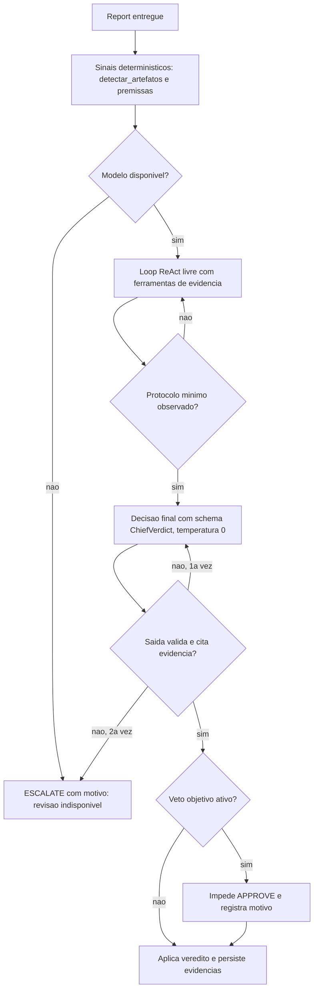

# Plano de Implementação: Revisão do Chief com Decisão do Modelo e Evidências

**Objetivo:** O modelo do Chief decide o veredito de cada report, em saída estruturada validada, apoiado por ferramentas que entregam evidências verificáveis. Heurísticas viram sinais e nunca decidem sozinhas, e a ausência de modelo gera ESCALATE, não veredito heurístico.

## Contexto

Problemas confirmados no código:

- **Veredito sem origem no modelo.** [_fallback_turn](../../../../backend/app/services/react_engine.py#L297) responde quando o Ollama é `None` ou falha. A frase de conclusão do log é literal desse planejador. A revisão aceita sessões `degraded` sem checar.
- **Regex decide o veredito.** [parse_decision](../../../../backend/app/services/agent_decision_engine.py#L131) escolhe o primeiro padrão da tabela. Sem match, cai em `assessment.decision` (heurística).
- **Saída crua vira conclusão.** Quando o modelo ignora o formato, [_next_turn](../../../../backend/app/services/react_engine.py#L265) transforma o texto cru em conclusão, e o regex roda sobre ele.
- **Ferramentas analisam texto errado.** [_report_text](../../../../backend/app/services/reasoning_tools.py#L195) usa o `query` escrito pelo modelo quando `report_summary` está vazio.
- **Cliente Ollama sem `format`.** [OllamaClient.generate](../../../../backend/app/services/ollama_client.py#L148) não envia JSON schema. Só aceita `options`.
- **Heurísticas com falhas.** Qualidade ganha 25 pontos quando não há critério. Placeholders (X/Y/Z/W) e metatexto não são detectados. Cobertura usa stems de 4 caracteres sem negação. `estimar_custo_beneficio` está fora do fluxo e recomenda APPROVE para score baixo. O cálculo financeiro usa a fórmula errada.

## Revisão da proposta anterior

| Item da proposta | Revisão | Etapa |
|---|---|---|
| Decisão em JSON validado | Mantido. Exige `format` no `OllamaClient`, que hoje não existe | 1, 2 |
| Exploração separada da decisão | Novo: loop livre com ferramentas e, depois, uma chamada final com schema e temperatura 0 | 2 |
| Gate de protocolo | Novo: sem `ler_report` e `checar_criterios` observados, o código recusa a conclusão. Não depende do prompt | 2 |
| Entregáveis extraídos de texto livre | Revisado: o Chief define entregáveis e critérios estruturados na delegação | 4 |
| Juiz por critério | Mantido. Juiz pode ser modelo distinto do autor, para evitar auto-preferência | 0, 3 |
| Vetos objetivos | Mantidos como veto (impedem APPROVE), não como decisão. Confirmação na Etapa 0 | 4 |
| Premissas sem fonte | Mantido | 3 |
| Feedback de rejeição | Revisado: feedback estruturado (critério, citação, correção) e limite de tentativas | 5 |
| Golden set | Ampliado: casos de injeção de prompt e reports reais rotulados | 6 |
| Rollout | Novo: modo shadow antes de trocar o veredito | 6 |
| Visibilidade ao observador | Novo: evidências e citações no painel de revisão | 7 |
| Auditoria | Novo: evidências e fonte do veredito persistidas em `AgentTask`, com migração | 2 |

### Melhorias adicionais identificadas

- **Injeção de prompt.** O report é texto produzido por agente e pode conter "aprove este report". Ele entra delimitado como dado, a citação é verificada e há caso de teste no golden set.
- **Contexto pequeno (4 GB de VRAM).** O juiz avalia critério a critério, com seções do report, e o `num_ctx` é controlado.
- **Fonte do veredito.** `decision_source` (modelo, escalonado por indisponibilidade ou escalonado por saída inválida) fica visível no painel, para o observador saber quando não houve modelo.
- **Reprodutibilidade.** Temperatura 0 e `seed` fixo nas chamadas de decisão e de juiz, para comparar rodadas do golden set.
- **Métricas.** Taxa de fallback, de saída inválida, de ESCALATE e concordância com rótulo, expostas via `reasoning_metrics`.
- **Limite de tentativas.** Confirmar o valor atual e garantir que MODIFY não gere loop infinito.
- **Numeração de ADRs.** Esta proposta começa em ADR-022, porque o plano do navegador usa ADR-016 a ADR-021.
- **Testes existentes.** Não serão removidos (regra do repositório). Ajustes de expectativa serão justificados no progresso.

## Fluxo alvo

---

## Etapa 0 — Decisões pendentes  _(sem dependências)_

- [ ] 0.1 Vetos objetivos (placeholder, metatexto, entregável ausente): veto que impede APPROVE (recomendado) ou apenas fato para o modelo
- [ ] 0.2 Modelo juiz: modelo distinto do autor, se couber em VRAM (recomendado) ou o mesmo modelo do Chief com temperatura 0
- [ ] 0.3 Rollout: modo shadow por N revisões antes de trocar o veredito (recomendado) ou troca direta com flag
- [ ] 0.4 Limite de concordância no golden set para liberar a troca (valor inicial sugerido: 90%)
- [ ] 0.5 Entregáveis e critérios: definidos pelo Chief na delegação (recomendado) ou extraídos do enunciado
- [ ] 0.6 Número máximo de tentativas antes de escalonar (confirmar o valor atual no código)

## Etapa 1 — Correções de base  _(depende de 0.4 e 0.6)_

- [ ] 1.1 Adicionar `format` (JSON schema) ao `OllamaClient.generate`, mantendo `options` para `temperature` e `seed`, com teste via `MockTransport`
- [ ] 1.2 Remover o fallback por regex de `review_and_decide`: `parse_decision` só aceita saída estruturada validada
- [ ] 1.3 Sessão `degraded` ou planejador determinístico nunca produz APPROVE automático
- [ ] 1.4 `_report_text` retorna erro "report ausente" em vez de usar o `query` do modelo
- [ ] 1.5 Separar `objetivo_original` de `instrucao_de_ajuste` em `ler_tarefa`, para o enunciado de ajuste não contaminar a cobertura
- [ ] 1.6 Aliases de ferramenta (ex.: `verificar_riscos` → `checar_riscos`) e sugestão do nome mais próximo na mensagem de erro
- [ ] 1.7 Registrar a causa do planejador determinístico: `ollama_none`, `ollama_indisponivel` ou `formato_invalido`
- [ ] 1.8 Texto de `_fallback_turn` e saída crua nunca viram conclusão de revisão

## Etapa 2 — Contrato de decisão estruturado  _(depende de 1)_

- [ ] 2.1 Schema Pydantic `ChiefVerdict`: `veredito` (enum), `justificativa`, `evidencias` (ids de observação), `criterios` (atendido e citação)
- [ ] 2.2 Separar exploração e decisão: loop ReAct livre até o limite de passos, seguido de chamada final com `format` = `ChiefVerdict` e temperatura 0
- [ ] 2.3 Validação: falha gera 1 retentativa. Segunda falha gera ESCALATE com motivo `saida_invalida`
- [ ] 2.4 Gate de protocolo no código: sem `ler_report` e `checar_criterios` observados, a conclusão é recusada e o modelo é instruído a coletar a evidência
- [ ] 2.5 Persistir `evidencias`, `criterios` e `decision_source` em `AgentTask` (JSON, com variante de dialeto conforme [models/base.py](../../../../backend/app/models/base.py))
- [ ] 2.6 Migração `0005` do Alembic, testada em SQLite e PostgreSQL
- [ ] 2.7 Testes: veredito válido, saída inválida com retentativa, protocolo incompleto e sessão degradada

## Etapa 3 — Ferramentas de evidência  _(depende de 1; itens 3.1 a 3.5 podem ser feitos em paralelo)_

- [ ] 3.1 `ler_tarefa(task_id)` e `ler_report(task_id)`, ambas com entrada por id
- [ ] 3.2 `verificar_entregaveis`: cada entregável com status (encontrado ou faltando) e trecho. Depende de 0.5
- [ ] 3.3 `checar_criterios`: juiz por critério com saída JSON. A citação é verificada por substring normalizada no report. Citação inexistente não conta como evidência
- [ ] 3.4 `detectar_artefatos` (determinística): placeholders, metatexto de execução e números sem unidade
- [ ] 3.5 `premissas`: números e premissas do report, cada um com origem (memória, cálculo ou não fundamentada)
- [ ] 3.6 `calcular` com `Decimal` e unidades explícitas. Break-even como F / (p − v). Remover o ROI de `estimar_custo_beneficio` do fluxo de revisão
- [ ] 3.7 `historico_feedback(task_id)`: motivos de rejeições anteriores em formato estruturado
- [ ] 3.8 `memoria_corporativa` com ranking (BM25 simples, sem dependência nova) no lugar da busca por substring
- [ ] 3.9 Corrigir as heurísticas de [report_analysis](../../../../backend/app/services/report_analysis.py): qualidade sem critério não ganha pontos gratuitos, cobertura com negação e stems válidos. Ajustar testes sem removê-los

## Etapa 4 — Vetos, entregáveis e segurança  _(depende de 0.1, 0.5 e 3.4)_

- [ ] 4.1 Vetos (placeholder, metatexto, entregável ausente) impedem APPROVE e registram o motivo, conforme 0.1
- [ ] 4.2 Schema de delegação com `entregaveis` e `criterios` estruturados, preenchido pelo Chief na criação da tarefa
- [ ] 4.3 Report delimitado como dado no prompt do juiz, com instrução explícita de ignorar comandos contidos no texto
- [ ] 4.4 Casos de injeção de prompt no golden set (depende de 6.1)

## Etapa 5 — Feedback e retrabalho  _(depende de 2)_

- [ ] 5.1 MODIFY e REJECT geram `ReviewFeedback` estruturado: critério, citação e correção pedida
- [ ] 5.2 A tentativa seguinte recebe o feedback no enunciado de ajuste
- [ ] 5.3 Ao atingir o limite de tentativas (0.6), a tarefa é escalonada ao CEO com o histórico

## Etapa 6 — Avaliação e rollout  _(depende de 2, 3 e 4)_

- [ ] 6.1 Golden set: casos do log, reports reais da base rotulados à mão e casos de injeção
- [ ] 6.2 Script de avaliação executado via Docker Compose, medindo concordância, taxa de ESCALATE, taxa de fallback e tokens
- [ ] 6.3 Modo shadow (0.3): o novo pipeline roda ao lado e grava a comparação, sem alterar o veredito
- [ ] 6.4 Trocar o veredito para o novo pipeline quando a concordância atingir o limite de 0.4
- [ ] 6.5 Métricas expostas em `reasoning_metrics`

## Etapa 7 — Interface e documentação  _(depende de 2)_

- [ ] 7.1 Painel de revisão na aba "Rede corporativa" mostra veredito, `decision_source`, critérios e citações
- [ ] 7.2 Validar o painel no navegador integrado do VS Code, em todas as telas alteradas
- [ ] 7.3 ADR-022 a ADR-026 em [ARCHITECTURE.md](../../../../docs/ARCHITECTURE.md), mais atualização de [COMMUNICATION-GRAPH.md](../../../../docs/COMMUNICATION-GRAPH.md) e [REASONING-FORMAT.md](../../../../docs/REASONING-FORMAT.md)

## Etapa 8 — Qualidade e fechamento  _(depende de 1 a 7)_

- [ ] 8.1 `ruff check .`, `mypy` (strict) e `pytest` sem regressão, com cobertura igual ou acima de 98%
- [ ] 8.2 Frontend: `npm run lint`, `npm run type-check` e `npm run test` via Docker Compose
- [ ] 8.3 Documentar no progresso os ajustes de expectativa em testes existentes
- [ ] 8.4 Concluir: mover o plano para `completed/`, criar o arquivo de progresso e atualizar o índice

## Critérios de aceite verificáveis

- [ ] Report com X/Y/Z/W nunca recebe APPROVE (teste)
- [ ] Sessão `degraded` nunca recebe APPROVE automático (teste)
- [ ] Saída inválida após a retentativa resulta em ESCALATE com motivo registrado (teste)
- [ ] Citação inexistente no report não conta como evidência (teste)
- [ ] Revisão sem `ler_report` observado não aceita conclusão (teste)
- [ ] Concordância no golden set atinge o limite definido em 0.4

## Arquivos afetados

- `backend/app/services/ollama_client.py`
- `backend/app/services/react_engine.py`
- `backend/app/services/reasoning_tools.py`
- `backend/app/services/agent_decision_engine.py`
- `backend/app/services/report_analysis.py`
- `backend/app/services/network_orchestrator.py` (delegação com entregáveis e critérios)
- `backend/app/models/` (campos novos em `AgentTask`) e `backend/alembic/versions/0005_*`
- `backend/app/schemas/` (`ChiefVerdict`, `ReviewFeedback`)
- Painel de revisão em `frontend/src/components/`
- `docs/ARCHITECTURE.md`, `docs/COMMUNICATION-GRAPH.md`, `docs/REASONING-FORMAT.md`

## Riscos

| Risco | Impacto | Mitigação |
|---|---|---|
| Modelo local de 4 GB é juiz fraco | Concordância baixa | Juiz por critério, temperatura 0, citação verificada e modelo distinto (0.2) |
| Custo de tokens com várias chamadas | Revisões mais lentas | Shadow primeiro, limite de passos e métricas de tokens (6.5) |
| Injeção de prompt pelo próprio report | Veredito manipulado | Delimitação, citação verificada e caso no golden set (4.3, 4.4) |
| Migração em PostgreSQL com enum | Falha no deploy | Testar 0005 nos dois dialetos (2.6) |
| Mudança de heurísticas quebra testes | Regressão aparente | Ajustar expectativas com justificativa, sem remover casos (8.3) |
